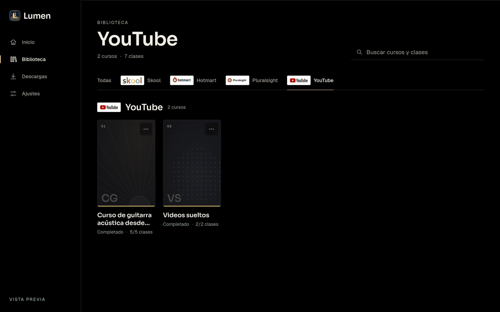
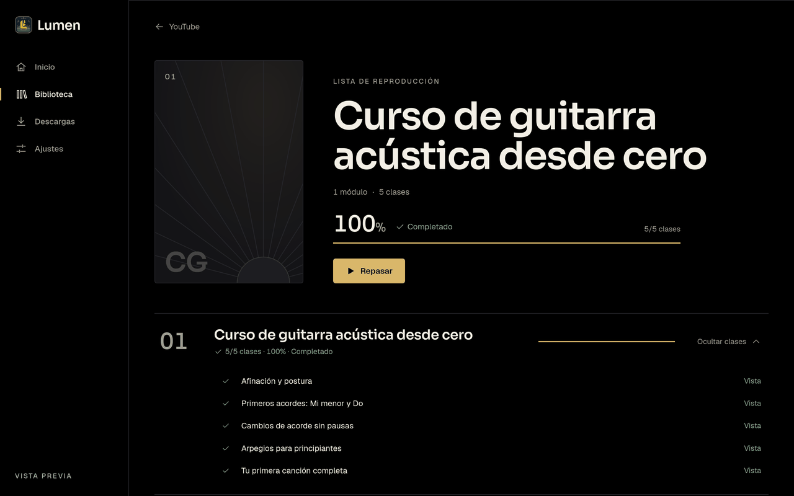
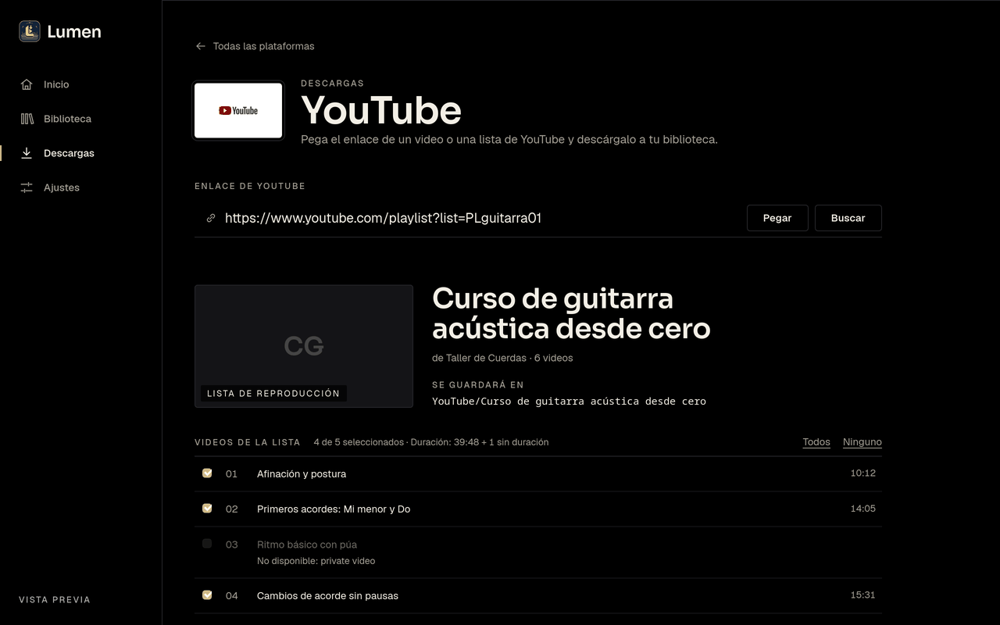

<p align="center">
  
</p>

<h1 align="center">Lumen</h1>

<p align="center">
  Download your purchased courses and watch them offline in a fast, focused classroom.
</p>

<p align="center">
  
  
  
</p>

<p align="center">
  
</p>

## What it does

- **Download** courses you already own from **Hotmart**, **Skool**, **Pluralsight** and **Golden Life** (sign in with your academy email and password), your **Harbiz** workouts (past and scheduled; each *Update* only fetches what is new), and single videos or playlists from **YouTube**.
  A guided check for **Udemy** tells you which of your courses are downloadable (DRM-protected ones are not); downloading from Udemy is not implemented yet.
  Videos go through `yt-dlp`; descriptions, attachments and linked files are saved next to each lesson.
  **Pause and resume** any running download (the item in flight finishes, then the queue waits), and every class that finishes shows up in the library while the rest of the queue keeps downloading.
- **Watch offline** in a built-in classroom: home with *continue where you left off*, a library with posters per course,
  per-module progress, and a player with custom controls (play/pause, *play from the start*, ±10 s, volume, *repeat*, speed, theatre mode, picture-in-picture and full screen) and keyboard shortcuts.
  A lesson with several videos is walked through in order, and the lessons panel lists them under the lesson that is playing (foldable).
- **Train along** with your Harbiz workouts: the player shows, over the video and out of the way, the exercise name, the instructions, a timer for the whole workout and the set you are on with its repetitions. See [Harbiz workouts](#harbiz-workouts).
- **Never fails silently**: every skipped or failed item ends up in a `download-report.json` and in the app.
  A course is only marked complete when nothing failed.
- **You own the files**: choose the library folder in *Ajustes*, and delete courses from the library
  (moved to the system trash by default, with a separate confirmation for permanent deletion).
  Deleting only removes files from your computer; it never touches your purchase or account.
- **Stay up to date**: *Ajustes → Actualizaciones* checks the GitHub releases and shows the notes and the right installer for your system.
  The repository is public, so no token is needed; an optional read-only token can be saved if you point Lumen to a private fork.

## Harbiz workouts

Sign in with your Harbiz email and password (Lumen keeps only a session token, never the password). Your agenda, past and scheduled, is saved as

```
Harbiz/Harbiz Training/<YYYY-MM>/<date - workout title>/
  NN. <exercise>.mp4      the demo video of each exercise (YouTube, through yt-dlp)
  NN. <exercise>.html     only that exercise: instructions, sets and your logged results
  Description.html        the workout summary and the exercises that have no video
  .workout.json           the agenda data of the class (hidden)
```

- **One class per workout**, so the library counts workouts; its exercises are the videos inside it and the lessons panel lists them.
- **Incremental**: *Update* only downloads what is not on disk yet, so workouts scheduled later are picked up on the next run. A new workout appears in the library only once it has finished downloading.
- **Coherent**: each video is tied to its exercise by name. If the coach renames, reorders or swaps the video of an exercise, the old file moves to a hidden `.replaced/` folder (nothing is deleted) and the right one is fetched. A video shared by several exercises is downloaded once.
- **Honest reports**: a video that no longer exists on YouTube is a warning with the reason and the full link, not a failure; after three YouTube bot checks in a row the run stops with one clear message instead of hundreds of errors.
- **In the player** (top corners of the video): the exercise name and its instructions on the left (a button hides them); on the right the workout timer and `Serie 2/3 · 10 reps` with a check button to mark the set and move to the next one. The timer counts only while the video plays, and an exercise with sets left repeats its video instead of moving on.

## Keyboard shortcuts

| Key | Action |
|---|---|
| `Space` / `K` | Play / pause |
| `0` / `Home` | Play from the start |
| `J` / `L` | Back / forward 10 s |
| `←` / `→` | Back / forward 5 s |
| `↑` / `↓` | Volume |
| `M` | Mute |
| `R` | Repeat the video until you move on |
| `S` | Mark the current set done (Harbiz workouts) |
| `Shift` + `<` / `>` | Slower / faster |
| `T` | Theatre mode |
| `F` | Full screen |
| `N` / `P` | Next / previous video (then lesson) |

## Download

Installers are published as GitHub releases ([latest](https://github.com/MAlexVR/lumen/releases)). Check files with `sha256sum -c SHA256SUMS.txt`.

| System | File | Notes |
|---|---|---|
| **Windows 11** | `Lumen_0.3.5_x64-setup.exe` | Per-user install, no administrator. Includes `yt-dlp` and `ffmpeg`. Not code-signed: SmartScreen warns ("More info" > "Run anyway"). **Not tested on a real machine yet.** |
| **Fedora / RHEL** | `Lumen-0.3.5-1.x86_64.rpm` | `sudo dnf install ./Lumen-0.3.5-1.x86_64.rpm` |
| **Debian / Ubuntu** | `Lumen_0.3.5_amd64.deb` | `sudo apt install ./Lumen_0.3.5_amd64.deb` |
| **Any Linux** | `Lumen_0.3.5_amd64.AppImage` | `chmod +x Lumen_0.3.5_amd64.AppImage && ./Lumen_0.3.5_amd64.AppImage` |

On Linux, video downloads use the system **`yt-dlp`** (and **`ffmpeg`**, recommended for merging audio and video):
`sudo dnf install yt-dlp ffmpeg-free` (Fedora; full `ffmpeg` needs RPM Fusion) or `sudo apt install yt-dlp ffmpeg`.
Lumen looks for them next to the app first and then on your `PATH`. Third-party components: [`THIRD_PARTY.md`](THIRD_PARTY.md).

## Screenshots

| Library | Course | Download |
|---|---|---|
|  |  |  |

## Design

*Black and light.* A true-black stage where the content glows: warm ivory text, one champagne-gold accent,
titles in [Sora](https://fonts.google.com/specimen/Sora), UI text in Geist, all fonts bundled locally.
Contrast follows WCAG 2.2 AA. The full palette and rules are in [`docs/PROPOSAL.md`](docs/PROPOSAL.md).

## What changed from vintecinco_dl

Lumen is a Rust rewrite of [vintecinco_dl](https://github.com/owbryd/vintecinco_dl) (Go + Wails).

- **Rust workspace + Tauri 2** with a Svelte 5 UI, one code base for Windows 11 and Linux. The previous Go code remains available in the git history.
- **Skool** reworked against the real site: course pages are read from HTML (the JSON endpoints are blocked by the WAF),
  every lesson page is fetched, and **native Skool videos (Mux)** are downloaded, which the Go version never did.
- **Hotmart** ported with the same on-disk layout, so existing downloads are recognised.
- **Local classroom**, progress stored in SQLite (watched lessons, last lesson, playback position), token-protected loopback media server.
- **Safer by design**: strict path confinement, Windows-safe file names (reserved names, `MAX_PATH`), cookies/tokens stored with restricted permissions and never logged.
- **Library folder picker** and **safe course deletion**.
- New brand and interface (see [Design](#design)).

See [`CHANGELOG.md`](CHANGELOG.md) for what changed in each version, [`docs/`](docs/README.md) for the architecture and stages, and [`odd/tasks/lumen.md`](odd/tasks/lumen.md) for the detailed task log with evidence.

## Run and build

Requirements: Rust (version pinned in `rust-toolchain.toml`), Node.js with pnpm, and the Tauri system libraries
(on Fedora: `webkit2gtk4.1-devel`). `yt-dlp` and `ffmpeg` are used for video downloads.

```bash
cd ui && pnpm install        # first time
pnpm tauri dev               # live development
pnpm tauri build --debug --no-bundle   # standalone debug binary (embeds the UI)
cargo test --workspace       # Rust tests
pnpm test                    # UI tests (from ui/)
```

> A plain `cargo build` produces a binary that looks for the dev server (`localhost:1420`) and shows a blank page.
> Use `pnpm tauri build` to embed the UI.

## Status

- Linux is the development and test platform. **Windows 11 is the target but has not been tested yet**:
  it is validated manually at milestones through the manual `windows` job in CI.
- Nothing has been run against live Hotmart or Skool in automated tests; the downloaders are verified against fixtures and fakes.
  Harbiz was checked read-only against the live service (sign-in and agenda listing); its video downloads are verified against fakes.
- Installers are built only for tagged versions, after tests pass (`git tag vX.Y.Z && git push origin vX.Y.Z` runs `.github/workflows/release.yml`). No binaries are stored in the repository.

## Credits and license

Derived from [vintecinco_dl](https://github.com/owbryd/vintecinco_dl) by vintecinco, released under the MIT license.
The original copyright notice is kept in [`LICENSE`](LICENSE). Platform logos shown in the app belong to their respective owners.
